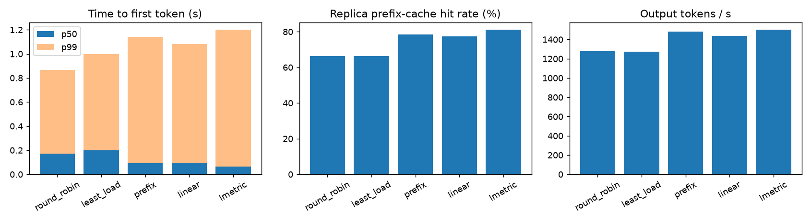

# KVRoute

A cache-aware request router for a fleet of vLLM replicas, plus a trace-replay
benchmark that compares routing policies on time to first token, tail latency,
throughput and prefix-cache hit rate.

When several vLLM replicas serve the same model, *where* a request goes decides
whether its prompt prefix (system prompt, chat history, agent tool schemas) is
already in that replica's KV cache. A cache hit skips that part of prefill; a
miss recomputes it. Sending everything with a shared prefix to one replica
maximises hits but overloads it. KVRoute scores both sides at once with
**LMetric** (Zhang et al., *Simple Is Better: Multiplication May Be All You
Need for LLM Request Scheduling*, OSDI '26):

```
score(replica) = new_prefill_tokens(replica) × batch_size(replica)      → route to the minimum
```

A replica wins by saving prefill or by being idle, in proportion, with no
weights to tune.

## How it works

```
client ──OpenAI API──► KVRoute ──► vLLM replica 0 … N
                         │  1. tokenize (model tokenizer + chat template)
                         │  2. hash full 16-token KV blocks, chained like vLLM
                         │  3. per replica: matched prefix (router's block index)
                         │                  and in-flight requests
                         │  4. policy picks a replica; stream the response back
                         └─ /metrics  ◄── scrapes each replica's /metrics
```

* **Router-side prefix index.** vLLM identifies a cached block by a hash chained
  over every token up to it. The router hashes each request's full blocks the
  same way and keeps an LRU set of block hashes per replica, sized to the
  replica's `num_gpu_blocks` (read from `vllm:cache_config_info`). The number
  of leading blocks a replica holds is the router's estimate of its cache hit.
  The router inserts blocks when it routes, so a burst of requests sharing a
  prefix sees it immediately.
* **Load.** In-flight requests per replica, tracked by the router (exact for a
  single router, no polling lag). Replica queue depth, KV-cache usage and the
  replica's *measured* prefix hit rate are scraped every second and exported
  for comparison.
* **Proxy.** aiohttp, OpenAI `/v1/completions` and `/v1/chat/completions`,
  streaming passthrough, retry on another replica if one is unreachable, and
  replicas marked down after repeated failures. Responses carry
  `X-KVRoute-Replica`, `X-KVRoute-Prompt-Tokens` and
  `X-KVRoute-Matched-Tokens`, so every request can be attributed.

## Policies

| Policy | Rule |
|---|---|
| `round_robin` | Next replica in turn |
| `least_load` | Fewest in-flight requests |
| `prefix` | Longest cached prefix, unless that replica is more than `max_imbalance` requests busier than the least-loaded one |
| `linear` | `α·new_prefill_tokens + β·(in_flight+1)`, the weighted sum most routers use (weights need tuning per workload) |
| `lmetric` | `new_prefill_tokens × (in_flight+1)` |

The paper leaves some LMetric details open; this implementation counts at least
1 new prefill token (vLLM always recomputes the last prompt token), counts the
routed request in the batch size so idle replicas still compare by prefill
cost, breaks ties by load and then by index, and offers an optional
`--hotspot-factor` guard that skips replicas far above the mean load, which is
the fallback the paper describes for heavily skewed prefixes.

The policy can be switched at runtime (`POST /router/policy`) and the router's
index and every replica's cache can be reset (`POST /router/reset?replicas=1`),
which the benchmark uses to run each policy from a cold start.

## Benchmark harness

* **Traces** (`kvroute.traces`): synthetic **multi-turn chat** (sessions start
  from one of a few shared system prompts and resend their whole history each
  turn) and **agent** workloads (a long shared instructions + tool-schema
  prefix per agent type, each step appending an action and a tool
  observation). Session starts are Poisson. Sessions are closed-loop: the next
  turn is sent after the previous response finishes plus a think time.
* **Replay** (`kvroute.replay`): streams every request, measuring TTFT at the
  client. Reports TTFT p50/p90/p99, end-to-end p50/p99, time per output token,
  output tokens/s, the router's estimated hit rate, the replicas' measured hit
  rate over the run (delta of `vllm:prefix_cache_hits/queries`), and load
  balance.
* **Compare** (`kvroute.bench`): resets caches, runs every policy on the same
  trace, then writes `comparison.md/.csv/.json` and a chart.

## Running it

### On a laptop (simulated replicas, no GPU)

`kvroute.mock_replica` serves the same API and the same metric names as vLLM
and simulates a continuous-batching engine with an LRU block prefix cache and
a step-time cost model (overhead + per prefill token + per decoding sequence).
Cache hits really shorten TTFT and busy replicas really slow down, but **the
timings are a model, not a GPU measurement.**

```bash
pip install -e ".[test,plot]"
pytest -q
python -m kvroute.bench --mock 4 --kind chat --scale 0.5 --rate-scale 2
make bench-mock-agent        # heavier agent workload
```

### On GPUs (real vLLM)

```bash
cd deploy
MODEL=Qwen/Qwen2.5-0.5B-Instruct docker compose up -d --build     # 4 GPUs
# one GPU: GPU_0=0 GPU_1=0 GPU_2=0 GPU_3=0 GPU_UTIL=0.2 docker compose up -d --build
cd ..
pip install -e ".[plot]"
python -m kvroute.bench --router http://localhost:8000 --kind chat  --model Qwen/Qwen2.5-0.5B-Instruct
python -m kvroute.bench --router http://localhost:8000 --kind agent --model Qwen/Qwen2.5-0.5B-Instruct
```

Prometheus is at `:9090` and Grafana at `:3000`. The provisioned **KVRoute**
dashboard shows TTFT p50/p99, requests and in-flight per replica, vLLM queue
depth, KV-cache usage, the router's estimated hit rate against the replicas'
measured hit rate, and router decision latency. `docker-compose.mock.yml`
runs the same stack with simulated replicas.

## Results

### Simulated replicas (cost model, not GPU numbers)

These runs check the harness end to end and show the trade-offs the policies
make. They come from `results/simulated/` and are a single run each.

**Agent workload**: 908 requests, 4 replicas, long shared prefixes, slower
prefill, small cache (`make bench-mock-agent`).

| policy | TTFT p50 (s) | TTFT p99 (s) | E2E p99 (s) | TPOT p50 (ms) | out tok/s | replica hit rate | max/mean load |
|---|---|---|---|---|---|---|---|
| round_robin | 0.173 | 0.866 | 6.35 | 21.6 | 1276 | 66.4% | 1.00 |
| least_load | 0.198 | 1.000 | 4.92 | 25.9 | 1274 | 66.3% | 1.04 |
| prefix | 0.092 | 1.142 | 4.16 | 13.2 | 1481 | 78.4% | 1.13 |
| linear | 0.095 | 1.083 | 4.17 | 13.0 | 1436 | 77.5% | 1.02 |
| lmetric | **0.064** | 1.199 | **3.79** | **11.3** | **1500** | **81.1%** | 1.08 |



In this simulation LMetric had the lowest median TTFT, end-to-end p99 and
per-token latency, and the highest hit rate and throughput, without the
weight tuning `linear` needs. **All cache-aware policies had a worse TTFT p99
than round-robin.** Concentrating requests that share a prefix occasionally
queues a long cache-missing prefill behind others on the same replica. This
is the trade-off to check first on real GPUs.

**Chat workload** (546 requests, light load): the cache-aware policies raise
the hit rate from about 56% to 75–79% and cut median TTFT by about 25%.
Throughput is set by the arrival rate at this load, so it doesn't change.
See `results/simulated/mock4_chat_x0.5/`.

### GPU

Not measured yet. Results from `deploy/docker-compose.yml` runs go in
`results/gpu/`, tagged with the GPU and model.

## Tests

```bash
pytest -q
```

* Block hashing (prefix chaining, partial blocks), LRU index, and every
  policy's decision rule, including LMetric's cache-versus-load trade-off and
  the hotspot guard.
* Parsing of vLLM's Prometheus output.
* End-to-end tests with simulated replicas: requests sharing a prefix land on
  the replica that cached it (and that replica reports the hit), streaming
  passthrough, router metrics, failover when a replica is down, runtime policy
  switch and reset, and a full trace replay where the router's estimated hit
  rate tracks the replicas' measured one.

CI runs the tests on Python 3.10 and 3.12 plus a small policy comparison.

## Limitations

* The router's index is an estimate. vLLM may evict blocks the router still
  lists; the scraped measured hit rate shows how far apart they are.
* A single router instance tracks load exactly; several routers would need to
  share state or use the scraped queue depth.
* Batched prompts are routed on their first prompt.
* The paper's two-phase hotspot detector is simplified to a load-cap guard.

## License

MIT
